<div align="center">
  
</div>

<div align="center">

**Find scholarships you can actually get — with sources you can actually check.**

A local-first desktop assistant that matches students to legitimate scholarship
opportunities and explains, requirement by requirement, why they do or do not fit.

<br>


<br>

[**Screenshots**](#-a-look-inside) · [**Features**](#-what-works-today) · [**Quick start**](#-quick-start) · [**Architecture**](#-architecture) · [**Privacy**](#-privacy)

</div>

<br>

<div align="center">
  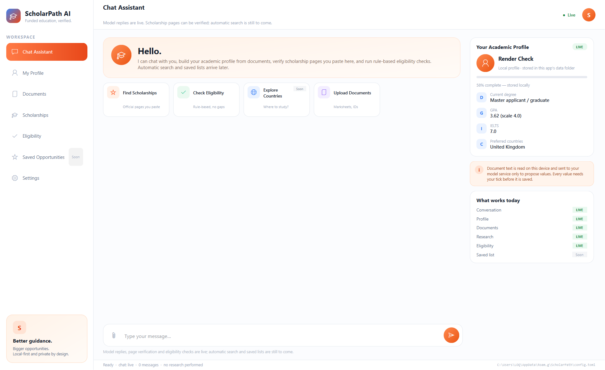
  <br>
  <sub><em>The real UI with sample data: chat, a local profile, catalog-backed discovery and page-verified records.</em></sub>
</div>

---

## 🎯 Why this exists

Scholarship advice online is mostly guesses: unverified deadlines, invented
funding amounts, "you're eligible!" with no source behind it. ScholarPath AI is
built on the opposite rule set.

| Principle | What it means in practice |
| --------- | ------------------------- |
| **Official sources only** | Universities, government portals, and programme administrators are the authority — not search snippets. |
| **Explainable eligibility** | Every requirement is reported as satisfied, unmet, unknown, or needs manual verification. Never a bare "you qualify". |
| **No fabrication** | If a fact cannot be verified, the app says so. It does not invent deadlines, amounts, or criteria. |
| **Local-first** | Profiles and academic documents stay on your machine. What may be sent is decided by three switches in Settings, and the app says who receives what. |
| **Honest failure** | A broken provider produces an error, never a plausible-looking answer. |

---

## 📸 A look inside

Eight screens, rendered from the shipped build with a **stub gateway** (the
green "Live" pill is illustrative) and **sample data** (a fictional profile and
fictional records). The UI is real; the data and the gateway status are not.
Click any image to open it full size.

<table>
  <tr>
    <td width="50%" valign="top">
      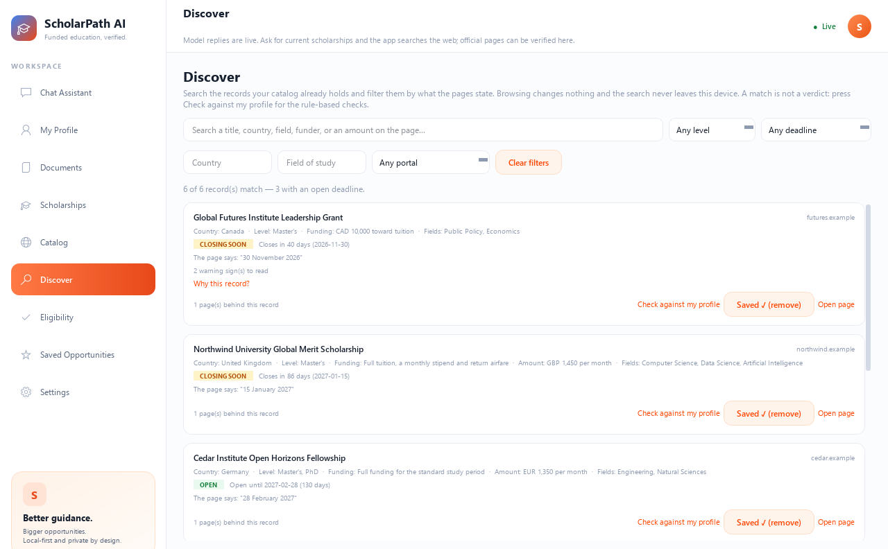
      <br>
      <sub><b>Discover</b> — search the stored catalog by title, country, field, funder, amount or deadline. Every card keeps the page's own deadline sentence beside the parsed state.</sub>
    </td>
    <td width="50%" valign="top">
      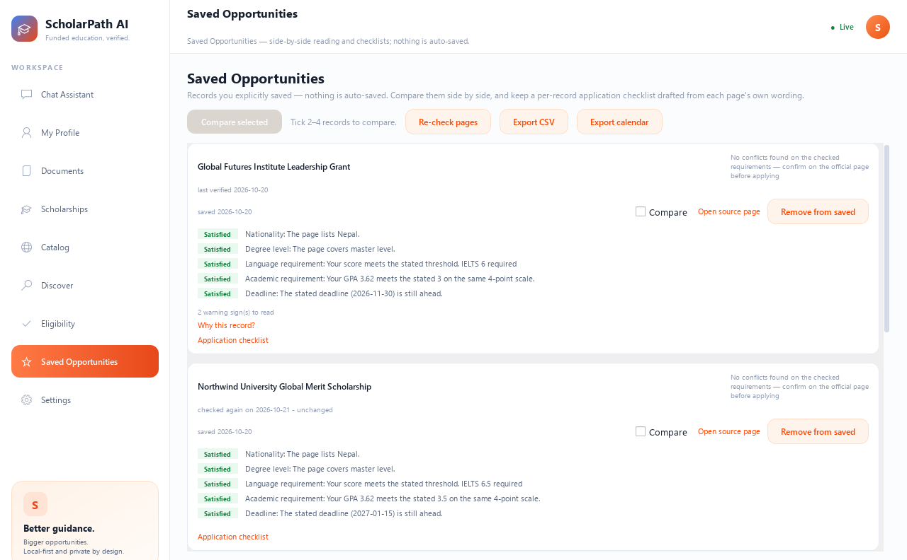
      <br>
      <sub><b>Saved Opportunities</b> — rule-based requirement states, warning signs, per-record checklists, re-check state and CSV/calendar export.</sub>
    </td>
  </tr>
  <tr>
    <td width="50%" valign="top">
      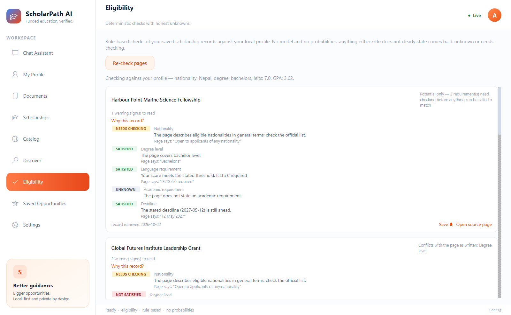
      <br>
      <sub><b>Eligibility</b> — satisfied, not satisfied, unknown or needs checking, each with the page sentence it was read from. No model, no probabilities.</sub>
    </td>
    <td width="50%" valign="top">
      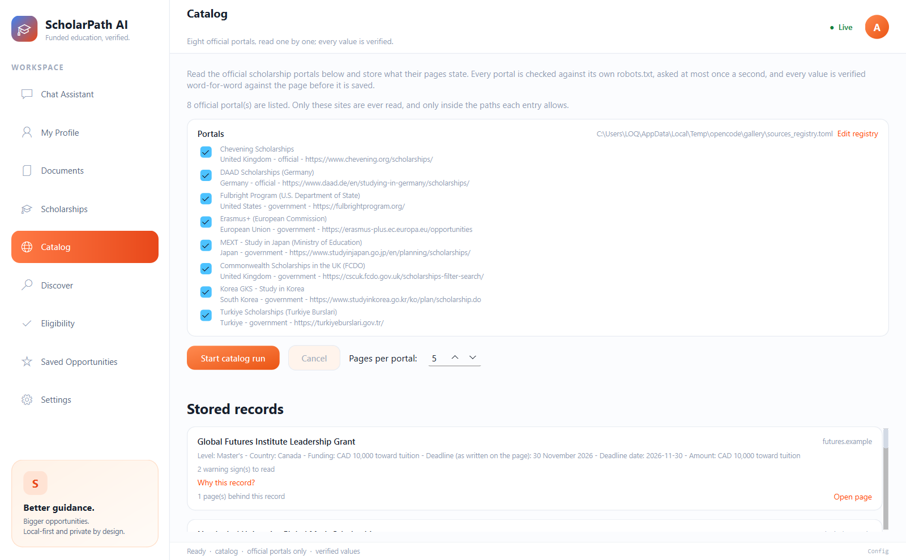
      <br>
      <sub><b>Catalog</b> — eight official portals, each read only inside its allowed paths, at most one request per second per host.</sub>
    </td>
  </tr>
  <tr>
    <td width="50%" valign="top">
      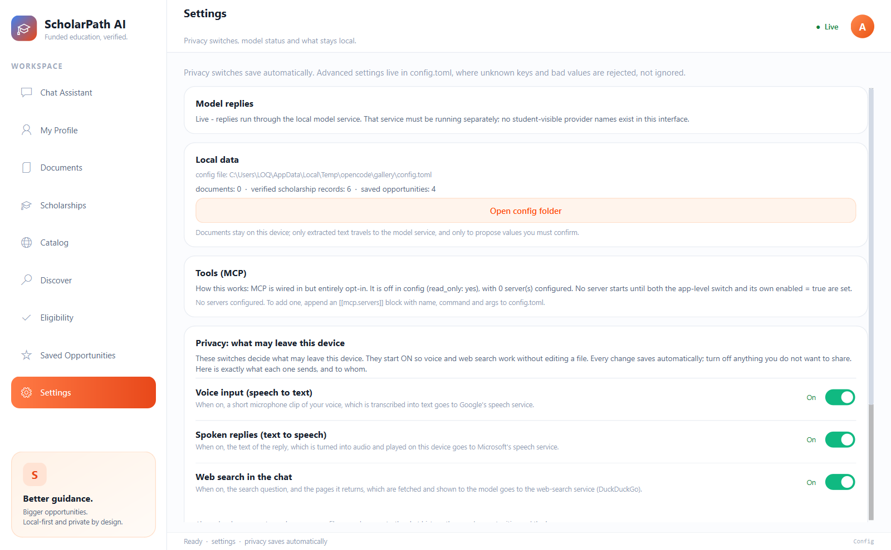
      <br>
      <sub><b>Settings</b> — what runs, what stays local, and the switches that decide what may leave the device.</sub>
    </td>
    <td width="50%" valign="top">
      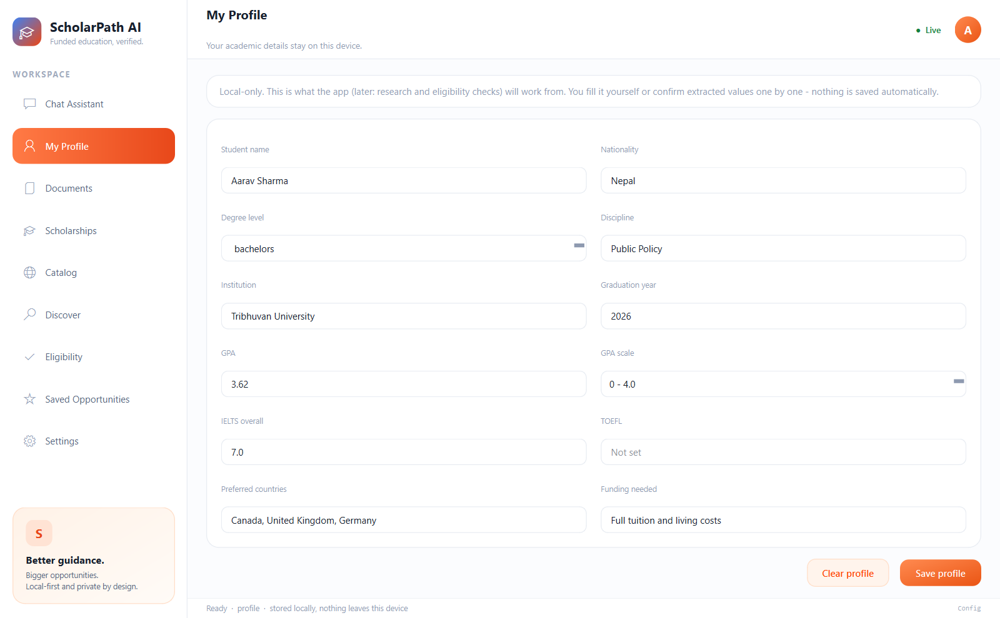
      <br>
      <sub><b>My Profile</b> — local only, with completion tracking and no invented values.</sub>
    </td>
  </tr>
</table>

> [!NOTE]
> The screenshots were taken with a **stub gateway**, so the "Live" status pill
> is illustrative and no model reply is shown. They use a **sample profile**
> ("Aarav Sharma") and **sample records created for this README**; the
> providers, deadlines and amounts are fictional (the links use reserved
> `.example` domains) and are not real scholarship data.

---

## 🚦 Status

> [!IMPORTANT]
> **M1–M6 and phases 1–3 of the discovery roadmap are done.** **M7 is packaged
> but not clean-Windows verified**: the folder build is produced and
> bundle-audited, but it has not been run on a freshly installed Windows, there
> is no installer, and no separate security/performance review exists yet.
>
> The discovery work is in: the app now walks **official scholarship portals**
> itself, lets you **search what they stated**, and **keeps those records
> true** — a background re-check re-reads a page that changed, keeps both
> versions and shows the field-by-field difference, while **warning signs**
> (payment wording, a lookalike domain, a missing source, a missing deadline)
> are shown next to the record instead of a verdict.
>
> Chat runs **live through the local OpenCode service**, profiles and documents
> work locally, and you can **verify a scholarship page**: paste the official
> URL, and only values that literally appear in the page text are offered —
> every saved record carries its source URL, retrieval time and page hash. The
> **Catalog** page reads a registry of official portals and stores what those
> pages state, merged into one record per scholarship; **Discover** searches and
> filters those records and hands one to the same deterministic eligibility
> checks. The chat can also **search the web**, list the
> scholarship links a site publishes, and the saved list **exports to CSV and to
> a calendar file**, with **opt-in deadline reminders**. Voice input and a spoken
> reply are available too — both **on by default** and switchable in Settings,
> because they send data to a third party. There is a packaged Windows build
> (`packaging\build.ps1`).

| # | Milestone | Status |
| - | --------- | :----: |
| M1 | Repository, config, desktop shell, chat loop | ✅ Done |
| M2 | OpenCode gateway adapter, model registry, task routing | ✅ Done |
| M3 | Profiles, document ingestion, OCR, confirmed extraction | ✅ Done |
| M4 | Source discovery, official-source verification, storage | ✅ Done |
| M5 | Deterministic eligibility, explainable ranking | ✅ Done |
| M6 | MCP tools behind adapter, comparison, saved opportunities, checklists | ✅ Done |
| M7 | Security review, performance, Windows packaging | 🟡 Packaged and bundle-audited — clean-Windows install and security review not done |
| P1 | Catalog: sources registry, crawler, background run, dedup + sources | ✅ Done — 8 official portals shipped |
| P2 | Discover: search + filters over the catalog, eligibility hand-off | ✅ Done |
| P3 | Freshness + safety: re-check job with diffs, reminders, export, warning signs | ✅ Done |

Full specification: [`goals.md`](goals.md) · Build log: [`achievements.md`](achievements.md)

---

## 🧰 What works today

### The student journey

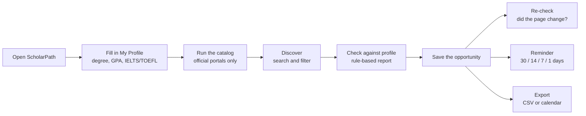

### 💬 Chat, with guardrails

- Native Qt window with a real chat loop (Enter to send, Shift+Enter for newline).
- **Live model replies** through the local OpenCode service (stub still available
  and switchable in config).
- **Chat captures your profile facts** — say "my name is …, I did IELTS 7.0"
  and every value is verified word-for-word against your own message, shown
  as an editable confirmation card in the transcript, and saved only to the
  rows you tick.
- **Replies read like a person wrote them** — the model is asked for plain,
  warm sentences with no formatting, and anything that still arrives as
  markdown is cleaned before you see it: no `**bold**`, no `--`, no headings,
  no table bars, no dash bullets. The chat bubble, the copy button and the
  spoken reply all get the same clean text.
- **The model behind it stays anonymous** — identity questions ("which model
  are you?") are answered deterministically without the model seeing them, a
  provider-neutral system prompt forbids disclosure, and any reply that names
  a model/provider token is withheld wholesale. Whichever provider is
  configured, the guard derives its tokens from config.
- **Web search in the chat** — ask for current scholarships ("scholarships in
  the UK for a master's in engineering") and the app **searches the web** and
  answers from what it found, naming the pages it used. The search is
  keyless (no account, no API key). Results are treated as untrusted
  third-party data, official-looking domains (universities, governments,
  scholarship bodies) are listed first, and every result is marked as
  official-looking or not — so you always know which page to trust and
  confirm on. If the search cannot run, the app says so instead of answering
  from memory.
- **Every address in a reply is a clickable link** — the answer stays plain
  prose, but each web address opens in the browser when you click it, in a
  strong blue that is easy to spot.
- **"Official" means the real thing** — the rule knows the government and
  university conventions of other countries too (`.edu.<cc>`, `.go.<cc>`,
  `.gov.<cc>`, `.ac.<cc>`, `.nic.in`, `.gc.ca`, `.gouv.fr`, `.gob.<cc>`,
  `.admin.ch`, `.gv.at`, `.govt.nz`), and it matches the registrable domain
  exactly, so a lookalike such as `university.edu.example.com` is never
  mistaken for the real one.
- **The chat uses what you already saved** — your profile is sent to the model
  as a short summary (degree level, GPA and scale, nationality, preferred
  countries, funding need, language scores) so the chat never asks you again.
  Your name and your documents are never part of it, and the switch in
  Settings turns it off.
- **Your verified catalog answers first** — before any web result, the chat
  searches the records you already stored (the same search as Discover) and
  cites each one with its source address and the date it was last verified.
  A web search result is only ever an **unverified lead**, and says so.
- **The chat knows your level** — if your profile says a bachelor's degree is
  completed, it prefers graduate-level programmes and says why in one line,
  and it tells you when a result is for another level.
- **"Verify this page"** — every official link in a reply gets a button that
  verifies **in the chat**: the page is read, every value is checked against
  the page itself, the checked values and the ones the page does not state are
  shown under the reply, and the record can be saved to your catalog from there.
  You never leave the conversation to do it.
- **Tools (MCP) are opt-in and read-only** — off by default; configured in
  `config.toml` per server. With `read_only = true`, only tools advertising
  `readOnlyHint` may run; tool output is size-capped data, never instructions.
  The Settings page shows honest status and can check a server's tool list.
- **Privacy switches you can flip** — the three switches that decide what may
  leave the device live on the Settings page, not in a file you have to edit.
  Flipping one saves your choice to `config.toml` and the running app obeys it
  at once.

### 🎓 Your profile, on your machine

- **My Profile page** — a local-only form (degree, GPA + scale, IELTS/TOEFL,
  countries, funding need) with completion tracking and no invented values.
- **Documents page** — upload a PDF, text file or image; text is read locally
  (PDF text layer, or Windows OCR for pictures); the model proposes fields; each
  proposal is checked **verbatim** against the document text and shown with a
  found / not-found marker; only rows you tick (and may edit) are merged.

### 🔎 Find and verify

- **Scholarship pages** — paste the official scholarship URL: the page is
  fetched with strict guardrails (http/https only, HTML only, 2 MB cap,
  redirect-aware provenance, sha256 + retrieval timestamp), fields are proposed
  and must be **verbatim** in the page text; untick the ones you distrust.
- **Find pages on a site** — paste a university's (or a funding portal's)
  scholarships page and press **Find pages**: the app lists the scholarship
  and funding links that page itself publishes, same site only, documents
  skipped, capped and de-duplicated. Click one and it goes straight through
  the same read-and-verify flow. Nothing is guessed — every link is read from
  the page, and the chat's own web search is a separate, opt-in feature.
- **Catalog page** — a registry of **official portals** (8 shipped: Chevening,
  DAAD, Fulbright, Erasmus+, MEXT, Commonwealth, Korea GKS, Turkiye Burslari;
  your editable copy lives at `%APPDATA%\ScholarPath\sources_registry.toml`).
  Switch portals on, set how many pages each may contribute, and press
  **Start catalog run**: the app discovers scholarship pages from each portal's
  sitemap, feed and same-site links, ranks the links by scholarship/funding
  words (English and common local languages) so the best pages are read first,
  obeys its `robots.txt`, reads **at most one page a second per host**, and only
  inside the paths the registry allows. Login forms, carts, news archives and
  calendars are never queued, and a run stops at 40 pages in total. A PDF the
  portal publishes is read through its text layer (a scan with none is reported
  as unread, never guessed at).
  Every value is still verified **word-for-word** against the page; a record is
  recognised by its title plus the portal's domain, so a second page **fills
  empty fields and adds a source** instead of duplicating the record, and a
  differing value is **kept** with the disagreement written down. The run shows
  progress, counts errors and can be cancelled between pages.
- **Discover page** — search the catalog by what the pages state. One search
  box (title, country, field, funder, amount, deadline wording) plus filters
  for level, country, field of study, portal and deadline state ("still open",
  "closing within 90 days", "already closed", "no readable date"). Results are
  ordered honestly (open deadlines first by date, then records with no readable
  date, then closed ones), and every card shows the page's own deadline
  sentence beside the parsed state. **Check against my profile** runs the same
  rule-based checks as the Eligibility page, and **Save** adds the record to
  Saved Opportunities. A match is a reading aid, never a verdict.

### 🛡️ Keep every record true

- **Re-check saved records** — the app re-fetches the stored pages in the
  background (the saved records first, then the most recent ones; guarded
  fetch, conditional requests, one request per second per host) and compares
  the sha256 with the copy that was saved. An unchanged page says so; a
  **changed** page is read again, every value is re-verified word-for-word
  against the new page text, the **older version is kept**, and **Show what
  changed** lists each field as old → new with the sentence the new value came
  from. A record is marked **EXPIRED** only when its stored, unambiguous
  deadline date lies before today — an ambiguous date stays "no date". A page
  that cannot be reached says **"could not re-check, last verified &lt;date&gt;"**
  and is never presented as fresh. **Re-check pages** on the Saved page runs it
  on demand; `[freshness]` decides whether it also runs at startup.

<div align="center">
  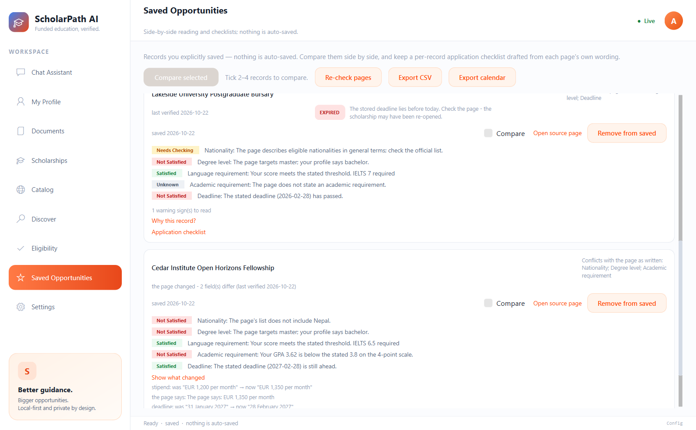
  <br>
  <sub><em>A changed page: the old value, the new value and the sentence it came from. The old version is kept; a page that timed out says so.</em></sub>
</div>

- **Warning signs on every card** — payment/fee wording on the page (with the
  sentence quoted), a domain that is neither official nor in your
  `trusted_domains` (exact registrable-domain match, so `harvard.edu.fake.com`
  and `chevening-scholarships.org` are caught), a missing source and a missing
  deadline. **Why this record?** explains each one. Nothing is hidden or
  deleted, and the wording says "warning sign" — never "scam", never "safe".
- **Eligibility page** — every saved record is checked by pure rule-based code
  against your local profile (nationality, degree level, language thresholds,
  grade average on a matching scale only, unambiguous deadlines). Results are
  satisfied / not satisfied / unknown / needs checking, each with the page text
  it was read from, ranked deterministically — **no model, no probabilities,
  and the word "eligible" is never claimed**; it only reports conflicts, gaps
  and "confirm on the official page".
- **Saved Opportunities page** — records you explicitly save (a Save ★ toggle
  on the eligibility and record cards; nothing auto-saves), side-by-side
  comparison labelled "a reading aid, not a ranking", and per-record
  application checklists drafted **only** from each page's own wording —
  if the page doesn't list documents or an application link, no steps are
  invented.
- **Deadline reminders** — opt-in (`[reminders] enabled`, **off by default**):
  Windows shows a local notification at 30, 14, 7 and 1 days before the
  deadline of a saved record, once per day, and only when the deadline date is
  unambiguous. Nothing is sent anywhere.
- **Export** — the saved list writes to **CSV** and to an **ICS calendar file**,
  both carrying the source URL, the deadline text **exactly as the page wrote
  it**, and the last verified date. Only records with a readable deadline
  become calendar events.

### 🎙️ Voice, only when you allow it

- **Voice input (speech to text)** — click the mic and speak; your words land
  as **editable text** in the composer for review before you press Enter
  (pause to finish, click again to stop early). While recording, the mic
  button plays an animated **listening ripple**. Uses the standard Python
  SpeechRecognition library: no Windows speech toggle, no model download, no
  API key — the audio clip is sent to Google's free speech service for
  transcription, and the app says so.
- **Live voice agent** — hit "Live voice" in the top bar and talk hands-free:
  the app listens, sends your words, and **speaks the reply aloud** in a
  natural neural voice (free Edge neural TTS — no API key; the offline
  Windows voice takes over automatically if the network is down), then
  listens again. The audio is synthesized by Microsoft's speech service and
  played on your own machine through the Windows audio engine. A voice bar
  always shows the real state (Listening / Thinking / Speaking) and names the
  voice in use, with an End button. Spoken text is markdown-free; the full
  reply stays in the chat, and the transcript follows the conversation as it
  grows. If a reply cannot be fetched, the app says so out loud and keeps
  listening instead of stopping.
  **Diagnosing it:** every Live turn writes `voice event=...` lines to the log
  with **numbers only** - how long the capture lasted, why it ended, whether a
  reply was playing while the microphone was open, which engine answered and
  the confidence when the service sends one. No audio and no words ever reach
  the log. To measure the loop on your own machine, run
  `.venv\Scripts\python.exe tools\voice_probe.py` and say the sentence it
  prints: it records your voice, plays a canned reply, records the room while
  and after it, and prints the heard text, the durations and how much of the
  reply the microphone picked up. Nothing is stored.
- **Privacy switches** — voice input, the spoken reply, web search and the
  profile context in the chat are
  **on by default**, so the features work without editing a file, and each one
  is a **real toggle in Settings**: flip it and the running app obeys it at
  once, and the choice is saved back to `config.toml` (comments and your other
  settings are left alone). The Settings page states exactly what each switch
  sends and to whom. While a switch is off, the mic and Live voice controls are
  disabled and greyed out; clicking one opens Settings at the privacy section.

### ⚙️ Under the hood

- Model registry + deterministic task routing (chat/classify/research/extract
  rules) built on the provider's advertised capabilities.
- Strict configuration: unknown keys and bad values are rejected, not ignored.
- Typed gateway contract — one seam for every model provider.
- Background execution so the window never freezes.
- Typed error surfaces: rate limit, timeout, unavailable, protocol error.
- Rotating logs that never contain message bodies or secrets.

---

## 🚫 What it deliberately does not do yet

> [!TIP]
> **You decide what leaves your device.** Voice input, the spoken reply and web
> search are on by default; the Settings page names the third party and the
> data for each one, and one click turns any of them off.

- Search results are **candidates, not proof**. A page is only "verified"
  when the values literally appear in its text; the app tells you which
  results come from an academic or government domain and which do not, and
  you can add the domains you trust yourself.
- GPA scale conversion and funding-type ranking are intentionally deferred until
  there is a documented, honest policy for them.
- The catalog is a **starting set of eight official portals**, not a complete
  index: it finds pages through sitemaps, feeds and same-site links (no search
  engine, no JavaScript menus), reads HTML and PDFs (a PDF through its text
  layer, size-capped; a scan with no text layer stays unread), and never goes
  faster than one request per second per host. Two portals were
  checked and left out because they could not be read: CSC (`csc.edu.cn`, HTTP
  412) and Australia Awards (`australiaawards.gov.au`, connection reset).
- Discover searches the **stored text**, so it is a reading aid, not a
  linguistic search: a word can match inside another word, level filters only
  match the page's own wording, and "closing soon" is a fixed 90-day window.
- The re-check job needs the app to be running: it looks at startup and every
  half hour while the window is open, not while it is closed. A changed page
  can only be re-read when the model service is available; without it the
  record says the page changed but could not be re-read, and the old copy is
  kept. Warning signs are **phrase-based** (a listed payment wording, the
  domain rule, a missing source, a missing deadline), so a page that asks for
  money in words the list does not contain is not flagged — the signs point at
  a page, they never clear it.
- Deadline reminders only fire while the app is running, only for saved records
  with an unambiguous stored date, and only at 30, 14, 7 and 1 days before it;
  there is no email or phone notification.
- MCP servers never start, and no model uses tools mid-conversation, until a
  concrete student-facing use and a documented injection policy exist.
- Extraction is a proposal engine, not an authority: a value the source does not
  literally contain is flagged and never applied without you typing it yourself.

That is the point: a smaller, truthful assistant beats an impressive one that
invents scholarships.

---

## ⚡ Quick start

**Requirements:** Windows 10/11 · Python 3.11+ · a running OpenCode service for
live replies (the stub provider and the test suite work offline).

```powershell
git clone https://github.com/RajeshKc777/ScholarPath-.git
cd ScholarPath-
python -m venv .venv
.\.venv\Scripts\Activate.ps1
python -m pip install -e ".[dev]"
scholarpath
```

<details>
<summary><strong>Other commands</strong></summary>

```powershell
scholarpath --init-config   # write the configuration template, then exit
scholarpath --config path\to\config.toml
scholarpath --version
python -m scholarpath       # equivalent to the console script
pytest                      # 682 tests, no network required (fake server on loopback)
```

</details>

---

## 📦 Build the Windows app

The app also ships as a self-contained Windows build - no Python needed on
the machine that runs it:

```powershell
powershell -ExecutionPolicy Bypass -File packaging\build.ps1
```

That installs PyInstaller, builds `dist\ScholarPathAI` (a folder build: the exe
plus its `_internal` runtime), and then **audits the bundle** - it fails the
build if a config, database, log, credential file or a secret-looking value ever
ends up inside it. The audit can also be run on its own:

```powershell
.\.venv\Scripts\python.exe packaging\verify_bundle.py
```

Rules the build keeps:

- **No user data in the build.** Config, database and logs live in
  `%APPDATA%\ScholarPath` and are created on first run, never shipped.
- **No secrets in the build.** API keys are read from the user's config or
  the environment at run time.
- **The Python runtime is bundled**, so the target machine does not need Python.
  The packaged build was run on this machine; a clean-Windows VM run is still
  to be done (see the live-proof checklist).
- Measured startup of the packaged build on this machine: **~1.6 s** to the
  first window.

---

## ⚙️ Configuration

Config lives outside the package so it survives upgrades:

```
%APPDATA%\ScholarPath\config.toml     # Windows
~/ScholarPath/config.toml             # other platforms
```

<details>
<summary><strong>Full config.toml template</strong></summary>

```toml
log_level = "INFO"            # top-level keys must come before the first [table]

[gateway]
provider = "stub"             # "stub" | "opencode" | "openai"
model = ""                    # "provider/model" or a bare id; empty = the provider default
models = []                   # failover chain when a model is rate-limited
fallback_providers = []       # e.g. ["opencode", "openai"]; tried after the primary
failover_attempts = 6         # model/account attempts per turn before an honest error
timeout_seconds = 30.0
retries = 1

# OpenCode adapter (empty = discover the running service automatically)
base_url = ""
service_file = ""
location_dir = ""
rotate_credentials = true     # ask the service to rotate accounts on a quota loss

# OpenAI-compatible adapter (only used when provider = "openai")
api_base_url = ""
api_model = ""                # endpoint's own model; empty = use model above
api_models = []               # endpoint's own chain; empty = use models above
api_keys = []                 # app's keys, tried in order; or SCHOLARPATH_API_KEYS
account_keys = []             # console keys rotated when a quota is exhausted

[ui]
theme = "dark"                # dark | light | system
window_width = 1100
window_height = 720

# What may leave this device. All three are ON by default; the Settings page
# has a toggle for each one and saves your choice here.
[privacy]
voice_stt = true    # microphone clip -> Google's speech service
voice_tts = true    # reply text -> Microsoft's speech service
web_search = true   # search question -> the web-search service

# Domains you trust for scholarship information (matched on the registrable domain).
[search]
trusted_domains = []

# Keeping the stored records true (saved records are always checked first).
[freshness]
auto = true
interval_hours = 24
max_per_run = 20

# Deadline reminders: OFF by default. A local Windows notification, nothing sent.
[reminders]
enabled = false

# Tools (MCP), opt-in and read-only by default. No server starts unless both
# mcp.enabled and the server's own enabled are true.
[mcp]
enabled = false
read_only = true

# [[mcp.servers]]
# name = "docs"
# command = "python"
# args = ["-m", "docs_server"]
# enabled = false
```

</details>

- `SCHOLARPATH_HOME` overrides the config folder; `--config` overrides the file.
- A missing file falls back to safe defaults. An **invalid** file is fatal
  (exit `2`) and names the offending field.
- Asking for a provider that is not implemented exits `3` with an explanation —
  it never silently downgrades to the stub.
- With `provider = "opencode"`, no secret goes in the config: the service
  password is read from OpenCode's registration file, or from the
  `OPENCODE_SERVICE_PASSWORD` environment variable when `base_url` is set.
- Template: [`config.example.toml`](config.example.toml) — contains no credentials.

### Sources registry (catalog)

The portals the **Catalog** page reads live in a separate file, so they can be
edited without touching config:

```
%APPDATA%\ScholarPath\sources_registry.toml   # your editable copy (created on first use)
src\scholarpath\data\sources_registry.toml    # the shipped default
```

Each `[[source]]` entry has `name`, `base_url`, `country`, `trust_level`
(`official` / `government`), `allowed_path_prefixes` (nothing outside them is
ever fetched), `crawl_depth` and `enabled`. Your copy wins; if it is broken the
Catalog page says so and refuses to run rather than silently falling back to the
shipped list.

---

## 🏗️ Architecture

### System map

Mermaid renders this on GitHub (and in VS Code's preview). Nothing in the
diagram is aspirational: every box names code that ships, and every arrow is a
call path that exists.

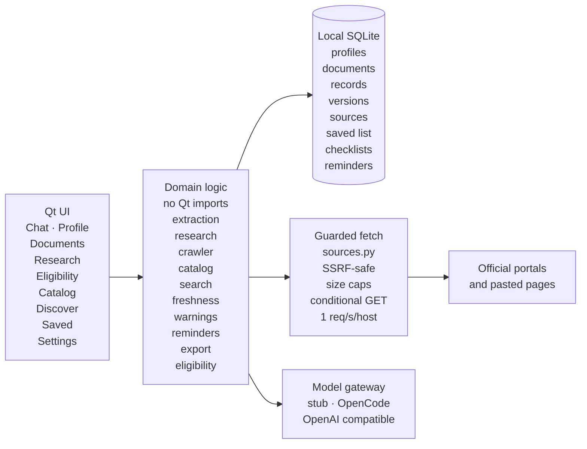

**Reading the map:** the UI never talks to a provider directly, and only
`gateway/` knows which provider is configured. The catalog and the re-check job
both go through the same guarded fetch, so the SSRF guard, the one-request-per-
second pacing and the conditional GET exist in exactly one place. Everything
except the gateway and `sources.py` can be tested with no network at all.

### How a scholarship record travels

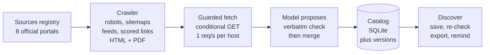

The steps in words, because the diagram is a summary:

1. **Registry** — eight official portals, each with allowed path prefixes,
   crawl depth and a trust level. Nothing outside those prefixes is fetched.
2. **Crawler** — discovers pages from `robots.txt`, sitemaps, RSS/Atom and
   same-site links, ranks the links by scholarship/funding words and reads the
   best first, one request per second per host, HTML and PDF (text layer),
   depth and page caps.
3. **Guarded fetch** — every page goes through `sources.py`: resolved-address
   check, size and type caps, every redirect re-checked, conditional GET with
   ETag / If-Modified-Since, sha256 recorded.
4. **Propose, verify, merge** — the model proposes values, each value is
   checked word-for-word against the page text, and only verified values are
   stored. Duplicates are merged by a canonical key; a conflicting value is
   kept and written down, never silently overwritten.
5. **Catalog** — SQLite records plus the source row per page and the version
   history used by the re-check job.
6. **Use** — Discover search and filters, the eligibility hand-off, the saved
   list, re-check differences, CSV/ICS export and the opt-in reminders. The
   warning signs sit beside every card.

### The re-check decision

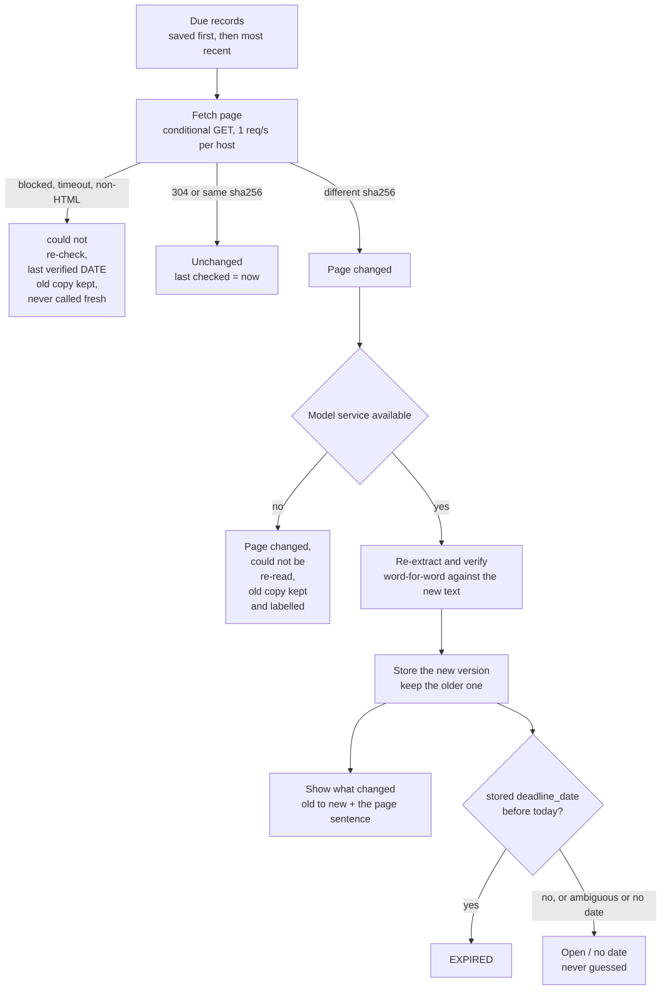

<details>
<summary><strong>File map</strong> — the modules behind the diagrams</summary>

```
src/scholarpath/
├── app.py                 entry point, startup checks, exit codes
├── config.py              TOML + pydantic models, strict validation
├── logging_setup.py       rotating logs, no payloads
├── storage.py             SQLite: profiles, documents, scholarships (+ catalog columns), sources, saved list, checklists
├── profiles.py            strict Profile model, merge_confirmed, completion
├── documents.py           PDF text layer (pypdf), plain text, Windows OCR images
├── extraction.py          prompt, JSON parsing, verbatim-verification against source
├── sources.py             guarded http(s) fetch: SSRF-safe resolution, caps, content-type, conditional GET, sha256, redirects
├── websearch.py           keyless web search: results, official-domain rule, untrusted-data block, unverified-lead labels
├── discovery.py           scholarship links published by a page the student trusts, plus RSS/Atom helpers
├── registry.py            sources registry: shipped default, editable user copy, strict validation
├── crawler.py             robots.txt, sitemaps, feeds, scored same-site links, pacing, depth/page caps, PDF text layer, 304s
├── catalog.py             the run: crawl → extract → verify → dedup/merge → save, honest stats, cancel
├── search.py              search + filters over the catalog: folded text, whole-word levels, deadline states
├── official.py            which domains count as official: exact registrable-domain rules, country conventions, trusted list
├── scam_flags.py          warning signs: payment wording, lookalike domain, missing source, missing deadline
├── freshness.py           the re-check job: saved first, hash compare, re-read + verify, versions, expiry
├── reminders.py           the reminder schedule (30/14/7/1 days) and its wording
├── export.py              the saved list as CSV and as an ICS calendar file
├── recheck.py             re-fetch a saved page: changed? deadline passed? reachable?
├── research.py            official-page pipeline: propose → verbatim verify → draft
├── eligibility.py         rule-based checks, honest verdicts, deterministic ranking
├── identity.py            provider anonymity: probe interception + reply withholding
├── chat_profile.py        chat-stated facts → verbatim-verified profile suggestions
├── prose.py               model markdown → plain prose for the bubble, the copy button and the voice, plus clickable links
├── chat_context.py        what the chat may know: profile summary, verified-catalog block, level rule, official links
├── tts.py                 spoken replies: neural voice first, offline Windows voice as fallback
├── voice.py               speech-to-text input: capture, transcription, honest errors, numbers-only diagnostics
├── mcp/
│   ├── __init__.py        exports
│   └── client.py          opt-in stdio MCP client: initialize/list/call, read-only guard
├── gateway/
│   ├── base.py            Message, ChatRequest/Response, typed errors, Protocol
│   ├── stub.py            offline, deterministic, self-describing
│   ├── registry.py        model catalogue, deterministic task routing
│   ├── opencode.py        adapter for the local OpenCode HTTP service
│   ├── openai_compat.py   adapter for any OpenAI-compatible endpoint
│   ├── chain.py           provider and model failover chain
│   ├── failover.py        rate-limit and quota handling
│   ├── credentials.py     key registration and rotation
│   └── factory.py         config → provider, explicit selection
└── ui/
    ├── chat_controller.py conversation state, busy handling, worker threads, web-search step
    ├── profile_page.py    local-only academic profile form
    ├── documents_page.py  upload → parse → propose → confirm → apply
    ├── research_page.py   official-page verification: URL → fields → save with provenance, plus Find pages
    ├── verify_worker.py   the page reader shared by the Scholarship Pages page and the chat (fetch → propose → check)
    ├── chat_verify.py     the panel that verifies a page inside a chat reply and saves it to the catalog
    ├── eligibility_page.py ranked rule-based eligibility reports with cited evidence
    ├── saved_page.py      saved list, comparison grid, checklists, re-check states, export
    ├── catalog_page.py    official portals, background catalog run, progress, errors, stored records
    ├── discover_page.py   search + filters over the catalog, cards, save, profile hand-off
    ├── eligibility_dialog.py one record's rule-based checks, reusing the Eligibility card
    ├── warnings.py        the warning-sign panel every record card shares
    ├── freshness.py       the background re-check worker (no UI code in the runner)
    ├── reminders.py       the Windows notification for a due deadline (local only)
    ├── recheck.py         the Re-check worker shared by the eligibility and saved pages
    ├── settings_page.py    the privacy switches that save to config.toml, plus honest status: model, local data, MCP tools
    ├── profile_suggestion.py transcript card confirming chat-stated facts
    ├── confirm_row.py     shared per-value confirm row (tick, edit, marker)
    ├── mic_button.py      microphone button with the listening ripple
    ├── theme.py           light Reddit-orange palette and widget styles
    └── main_window.py     stacked pages, sidebar, transcript, status strip, voice mode
tools/
└── voice_probe.py        one Live voice cycle on the real mic: echo, levels, durations (owner tool)
```

</details>

**Layering rule:** nothing outside `gateway/` may know which model provider is in
use. Later milestones add `agents/`, `research/`, `storage/`, and `mcp/` behind
the same discipline — business logic stays testable without a network or a model.

---

## ✅ Quality gates

| Gate | How it is enforced |
| ---- | ------------------ |
| Tests | `pytest` — config validation, gateway contract, model routing, adapter round-trips against a fake server, chat turns, failure paths, verbatim extraction checks, SQLite profile/document/scholarship round-trips, fetch guardrails (including SSRF blocking) against a fake HTTP server, privacy switches, UI privacy gates and status elision, re-check logic, sources registry validation, crawler (robots, sitemaps, feeds, redirects, 304, pacing, page cap), the catalog run (dedup, merge, conflicts, invented values, cancel, old-database migration), Discover (text folding, whole-word levels, five deadline states, filter isolation, ordering, empty states, the hand-off, navigation) and Phase 3 (unchanged / changed / failed re-check, version history, expiry only from a stored date, the stored difference, reminder schedule and no repeats, CSV + ICS content, every warning sign and lookalike domain, the never-a-verdict wording check) |
| Honesty | Extraction values must appear verbatim in the source (document or fetched page); unverified proposals are visibly flagged and never auto-applied |
| Untrusted input | Fetched page content is data only, wrapped in markers with an explicit ignore-instructions instruction |
| Secrets | Never in source or config templates; config is local + git-ignored |
| Types | Type hints on public interfaces; frozen dataclasses for shared data |
| Errors | Typed gateway exceptions surfaced to the user, never swallowed |
| Logs | Event names and identifiers only — no message bodies, documents, or keys |
| Dependencies | Verified, not assumed; a broken system `mcp` install was caught this way |

---

## 🔒 Privacy

- Profiles, documents, and verified scholarship records are stored locally in
  `%APPDATA%\ScholarPath\scholarpath.db`; uploaded files are parsed on this
  device (PDF text layer or Windows OCR).
- Chat messages are sent to the configured model service to produce a reply.
  When you extract fields, the document's **text** is sent to the service for a
  proposal. When you verify a scholarship page, that page's **text** is sent the
  same way. Files and the fetching of pages happen model-free on your machine.
- Fetching a page is a normal web visit by this app (its User-Agent is
  `ScholarPath-AI/0.1`); the site sees it like any other visitor.
- Facts you type into chat are sent to the model service twice: once for the
  reply, and once as a marked, data-only extraction task whose only allowed
  output is values verbatim from your own words. A suggestion is then shown
  to you; nothing is saved to your profile without your tick.
- The privacy disclosure rule runs in code, not good intentions: identity
  probes never reach the model, and a leaking reply is withheld wholesale.
- MCP servers are opt-in, read-only by default, and their output is treated
  exactly like fetched web content: data, capped, never executed.
- Nothing is uploaded to a ScholarPath server — there isn't one. Deletion
  controls live on the profile, documents, and research pages; deleting a
  scholarship record also removes its saved entry and checklist items.

### What crosses the device boundary

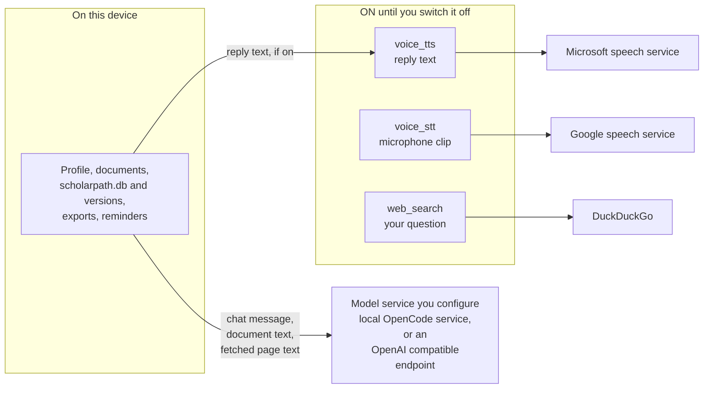

The arrows out of the "on until you switch it off" box exist only while that
switch is on; the Settings page has a toggle for each one and names the third
party and the data it sends. Deadline reminders are Windows notifications
drawn on this machine and send nothing.

---

## 📄 License

**Proprietary — view only. All rights reserved.**

This repository is public so the work can be inspected. It is **not** open
source, and no permission is granted to copy, modify, redistribute, or reuse any
part of it. Pull requests are not accepted.

See [`LICENSE`](LICENSE) for the exact terms. Permission requests:
[@RajeshKc777](https://github.com/RajeshKc777).

<br>

<div align="center">
<sub>ScholarPath AI is not affiliated with any university, government body, or scholarship provider.</sub>
</div>
